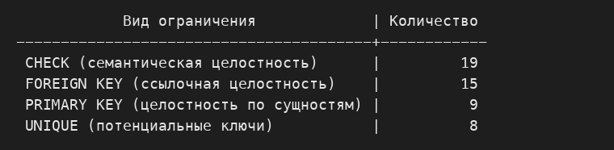
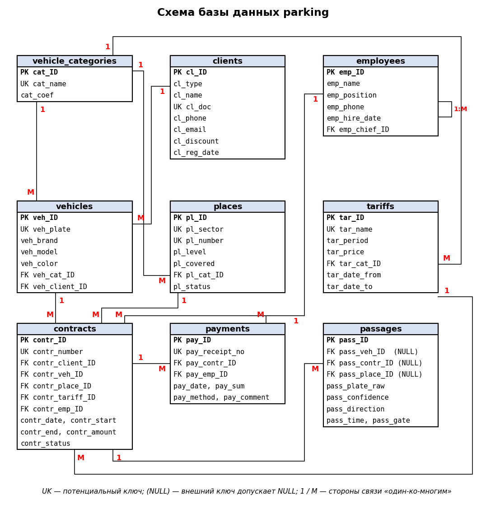

{{json
{
  "discipline": "Базы данных",
  "title": "Создание базы данных, таблиц и связей в PostgreSQL. Вариант 11 — «Автостоянка»",
  "student": {"name": "Харлова Никиты Станиславовича", "course": "2", "group": "ФИТ-242", "program": "02.03.02"},
  "teacher": {"title": "асс. Григор А.А.", "name": ""},
  "institution": {"short": "ОмГТУ", "department": "ПМиФИ", "year": "2026"},
  "work": {"type": "Лабораторная работа № 2"}
}
}}

# СОДЕРЖАНИЕ

# ВВЕДЕНИЕ

Цель работы — создать в СУБД PostgreSQL 16 физическую базу данных `parking` для предметной области «Автостоянка» (вариант 11 расчётно-графической работы): базу данных, девять связанных таблиц, ограничения целостности и индексы. Клиентское приложение — pgAdmin 4.

Предметная область описана тремя исходными документами: «Договор с клиентом», «Квитанция об оплате услуги автостоянки» и «Электронная регистрация на въезде по государственному номеру автомобиля». Логическая модель содержит девять сущностей: КЛИЕНТ, СОТРУДНИК, КАТЕГОРИЯ ТС, ТРАНСПОРТНОЕ СРЕДСТВО, МАШИНО-МЕСТО, ТАРИФ, ДОГОВОР, КВИТАНЦИЯ и ПРОЕЗД.

# ОСНОВНАЯ ЧАСТЬ

## Описание ограничений целостности

Для надёжного хранения данных и соответствия бизнес-логике автостоянки в базе данных реализованы три вида целостности. Всего создано 51 ограничение, не считая `NOT NULL`.

### 1.1 Целостность по сущностям

Каждая из девяти таблиц имеет первичный ключ `PRIMARY KEY` — суррогатный числовой атрибут `*_ID`. Ограничение сочетает `UNIQUE` и `NOT NULL`, исключает дублирующиеся записи и создаёт уникальный индекс B-дерева. Суррогатный ключ выбран потому, что естественный ключ транспортного средства — государственный номер — может измениться при перерегистрации, а на транспортное средство ссылаются договоры и журнал проездов.

Естественные потенциальные ключи объявлены ограничениями `UNIQUE`, как показано в таблице 1.

Таблица: Первичные и потенциальные ключи таблиц

| Таблица | Первичный ключ | Потенциальный ключ (UNIQUE) |
|---|---|---|
| vehicle_categories | cat_ID | cat_name |
| clients | cl_ID | cl_doc |
| employees | emp_ID | — |
| vehicles | veh_ID | veh_plate |
| places | pl_ID | (pl_sector, pl_number) |
| tariffs | tar_ID | (tar_name, tar_cat_ID, tar_date_from) |
| contracts | contr_ID | contr_number |
| payments | pay_ID | pay_receipt_no |
| passages | pass_ID | (pass_plate_raw, pass_time, pass_direction) |

Ограничения уникальности защищают от двойного ввода: государственный номер, номер договора и номер квитанции не повторяются, а машино-место однозначно определяется адресом «сектор + номер». Составной ключ таблицы `passages` отражает физический смысл: камера не может дважды зафиксировать один и тот же номер в одном направлении в один момент времени.

### 1.2 Ссылочная целостность

Ссылочная целостность реализована пятнадцатью ограничениями внешних ключей `FOREIGN KEY`, которые связывают таблицы по принципу «один ко многим». Например, нельзя создать договор со ссылкой на несуществующего клиента, машино-место или сотрудника. Для всех связей задано правило `ON UPDATE CASCADE`.

Правило `ON DELETE CASCADE` задано для двенадцати связей: договор не существует без клиента, квитанция — без договора. Правило `ON DELETE SET NULL` задано для трёх связей таблицы `passages` и для рекурсивной связи «руководитель — подчинённый» таблицы `employees`: запись о проезде и подчинённые сотрудники должны сохраняться после удаления родительской строки. Распределение правил показано в таблице 2.

Таблица: Внешние ключи и правила удаления

| Внешний ключ | Дочерняя таблица | Родительская таблица | ON DELETE |
|---|---|---|---|
| employees_FK | employees | employees | SET NULL |
| vehicles_FK1 | vehicles | clients | CASCADE |
| vehicles_FK2 | vehicles | vehicle_categories | CASCADE |
| places_FK | places | vehicle_categories | CASCADE |
| tariffs_FK | tariffs | vehicle_categories | CASCADE |
| contracts_FK1 | contracts | clients | CASCADE |
| contracts_FK2 | contracts | vehicles | CASCADE |
| contracts_FK3 | contracts | places | CASCADE |
| contracts_FK4 | contracts | tariffs | CASCADE |
| contracts_FK5 | contracts | employees | CASCADE |
| payments_FK1 | payments | contracts | CASCADE |
| payments_FK2 | payments | employees | CASCADE |
| passages_FK1 | passages | vehicles | SET NULL |
| passages_FK2 | passages | contracts | SET NULL |
| passages_FK3 | passages | places | SET NULL |

Столбцы внешних ключей объявлены `NOT NULL` везде, где связь обязательна. Значение NULL допускается только для `emp_chief_ID` (у руководителя организации нет начальника) и для трёх внешних ключей таблицы `passages`: камера фиксирует и незарегистрированный автомобиль.

### 1.3 Семантическая целостность

Семантическая целостность достигается строгим определением типов данных (числовые типы для идентификаторов и сумм, символьные для названий и номеров, `date` и `timestamp` для дат), ограничениями `NOT NULL`, значениями `DEFAULT` и девятнадцатью ограничениями `CHECK` на уровне СУБД. Основные из них:

- тип клиента ограничен значениями «Ф» (физическое лицо) и «Ю» (юридическое лицо), скидка находится в диапазоне 0–30 %;
- статус договора ограничен значениями «оформлен», «действующий», «завершён», «расторгнут»; статус машино-места — «свободно», «занято», «ремонт»;
- способ оплаты ограничен значениями «наличные», «карта», «перевод»; сумма квитанции строго положительна;
- направление проезда ограничено значениями `IN` и `OUT`, достоверность распознавания номера лежит в диапазоне 0–1;
- длина государственного номера составляет 8 или 9 символов;
- дата окончания договора не раньше даты начала, а у бессрочного договора равна NULL.

Во избежание двойного ввода данных на уровне СУБД действуют ограничения уникальности из таблицы 1. Они работают как встроенный бизнес-триггер, блокирующий ошибочные транзакции.

## Создание БД, таблиц и связей в PostgreSQL

Физическая база данных создаётся в последовательности, исключающей конфликты внешних ключей: сначала независимые справочники (категории ТС, клиенты, сотрудники), затем таблицы, которые на них ссылаются, и в конце транзакционные таблицы (договоры, квитанции, проезды). Скрипты выполнены на PostgreSQL 16.15 без ошибок.

### 2.1 Создание базы данных

Листинг: Создание базы данных parking

```sql
CREATE DATABASE parking
    WITH
    OWNER            = postgres
    ENCODING         = 'UTF8'
    LC_COLLATE       = 'Russian_Russia.1251'
    LC_CTYPE         = 'Russian_Russia.1251'
    TEMPLATE         = template0
    TABLESPACE       = pg_default
    CONNECTION LIMIT = -1
    IS_TEMPLATE      = False;

COMMENT ON DATABASE parking
    IS 'База данных автостоянки: договоры с клиентами, транспортные средства, электронная регистрация проездов по госномеру, оплата услуг';
```

Протокол выполнения скрипта `lab2_parking_db.sql` показан на рисунке 1.


База данных создана со следующими характеристиками: владелец — суперпользователь `postgres`; кодировка UTF-8; порядок сортировки и классификация символов — локаль `Russian_Russia.1251`; табличное пространство `pg_default`; число одновременных подключений не ограничено; база не является шаблоном. Указание `TEMPLATE = template0` необходимо, потому что заданная локаль может отличаться от локали шаблона `template1`.

### 2.2 Создание таблиц

Инструкции `CREATE TABLE` содержат только имена столбцов, типы, `NOT NULL` и первичный ключ. Остальные ограничения вынесены в отдельные инструкции `ALTER TABLE`: так запрос создания проще читать, а ограничения проще изменять и удалять.

Листинг: Создание справочных таблиц

```sql
CREATE TABLE vehicle_categories (
    cat_ID   integer NOT NULL,
    cat_name text NOT NULL,
    cat_coef numeric(4,2) NOT NULL,
    CONSTRAINT categories_PK PRIMARY KEY (cat_ID)
);

CREATE TABLE clients (
    cl_ID       integer NOT NULL,
    cl_type     char(1) NOT NULL,
    cl_name     text NOT NULL,
    cl_doc      varchar(20) NOT NULL,
    cl_phone    varchar(20) NOT NULL,
    cl_email    varchar(60),
    cl_discount integer NOT NULL,
    cl_reg_date date NOT NULL,
    CONSTRAINT clients_PK PRIMARY KEY (cl_ID)
);

CREATE TABLE employees (
    emp_ID        integer NOT NULL,
    emp_name      text NOT NULL,
    emp_position  text NOT NULL,
    emp_phone     varchar(20),
    emp_hire_date date NOT NULL,
    emp_chief_ID  integer,
    CONSTRAINT employees_PK PRIMARY KEY (emp_ID)
);
```

Листинг: Создание таблиц транспортных средств, мест и тарифов

```sql
CREATE TABLE vehicles (
    veh_ID        integer NOT NULL,
    veh_plate     varchar(12) NOT NULL,
    veh_brand     text NOT NULL,
    veh_model     text NOT NULL,
    veh_color     text,
    veh_cat_ID    integer NOT NULL,
    veh_client_ID integer NOT NULL,
    CONSTRAINT vehicles_PK PRIMARY KEY (veh_ID)
);

CREATE TABLE places (
    pl_ID      integer NOT NULL,
    pl_sector  varchar(5) NOT NULL,
    pl_number  integer NOT NULL,
    pl_level   integer NOT NULL,
    pl_covered boolean NOT NULL,
    pl_cat_ID  integer NOT NULL,
    pl_status  text NOT NULL,
    CONSTRAINT places_PK PRIMARY KEY (pl_ID)
);

CREATE TABLE tariffs (
    tar_ID        integer NOT NULL,
    tar_name      text NOT NULL,
    tar_period    text NOT NULL,
    tar_price     numeric(10,2) NOT NULL,
    tar_cat_ID    integer NOT NULL,
    tar_date_from date NOT NULL,
    tar_date_to   date,
    CONSTRAINT tariffs_PK PRIMARY KEY (tar_ID)
);
```

Листинг: Создание таблиц договоров, квитанций и проездов

```sql
CREATE TABLE contracts (
    contr_ID        integer NOT NULL,
    contr_number    varchar(20) NOT NULL,
    contr_client_ID integer NOT NULL,
    contr_veh_ID    integer NOT NULL,
    contr_place_ID  integer NOT NULL,
    contr_tariff_ID integer NOT NULL,
    contr_emp_ID    integer NOT NULL,
    contr_date      date NOT NULL,
    contr_start     date NOT NULL,
    contr_end       date,
    contr_amount    numeric(10,2) NOT NULL,
    contr_status    text NOT NULL,
    CONSTRAINT contracts_PK PRIMARY KEY (contr_ID)
);

CREATE TABLE payments (
    pay_ID         integer NOT NULL,
    pay_receipt_no varchar(20) NOT NULL,
    pay_contr_ID   integer NOT NULL,
    pay_emp_ID     integer NOT NULL,
    pay_date       timestamp NOT NULL,
    pay_sum        numeric(10,2) NOT NULL,
    pay_method     text NOT NULL,
    pay_comment    text,
    CONSTRAINT payments_PK PRIMARY KEY (pay_ID)
);

CREATE TABLE passages (
    pass_ID         integer NOT NULL,
    pass_veh_ID     integer,
    pass_contr_ID   integer,
    pass_place_ID   integer,
    pass_plate_raw  varchar(12) NOT NULL,
    pass_confidence numeric(4,3) NOT NULL,
    pass_direction  varchar(3) NOT NULL,
    pass_time       timestamp NOT NULL,
    pass_gate       varchar(10) NOT NULL,
    CONSTRAINT passages_PK PRIMARY KEY (pass_ID)
);
```

Результат выполнения скрипта `lab3_parking_tables.sql` показан на рисунке 2: сервер девять раз вернул сообщение `CREATE TABLE`.


### 2.3 Ограничения целостности и связи между таблицами

Ограничения уникальности, значения по умолчанию и проверки добавляются после создания таблиц.

Листинг: Ограничения по сущностям и семантическая целостность

```sql
ALTER TABLE vehicles ADD CONSTRAINT vehicles_UK UNIQUE (veh_plate);
ALTER TABLE places   ADD CONSTRAINT places_UK   UNIQUE (pl_sector, pl_number);
ALTER TABLE payments ADD CONSTRAINT payments_UK UNIQUE (pay_receipt_no);

ALTER TABLE places    ALTER COLUMN pl_status    SET DEFAULT 'свободно';
ALTER TABLE contracts ALTER COLUMN contr_status SET DEFAULT 'оформлен';
ALTER TABLE payments  ALTER COLUMN pay_date     SET DEFAULT now();

ALTER TABLE vehicles ADD CONSTRAINT vehicles_CK_plate
CHECK (length(veh_plate) BETWEEN 8 AND 9);

ALTER TABLE contracts ADD CONSTRAINT contracts_CK_dates
CHECK (contr_end IS NULL OR contr_end >= contr_start);

ALTER TABLE payments ADD CONSTRAINT payments_CK_sum CHECK (pay_sum > 0);
```

Листинг: Определение внешних ключей

```sql
ALTER TABLE employees
ADD CONSTRAINT employees_FK FOREIGN KEY (emp_chief_ID)
REFERENCES employees (emp_ID)
ON DELETE SET NULL
ON UPDATE CASCADE;

ALTER TABLE contracts
ADD CONSTRAINT contracts_FK5 FOREIGN KEY (contr_emp_ID)
REFERENCES employees (emp_ID)
ON DELETE CASCADE
ON UPDATE CASCADE;

ALTER TABLE payments
ADD CONSTRAINT payments_FK1 FOREIGN KEY (pay_contr_ID)
REFERENCES contracts (contr_ID)
ON DELETE CASCADE
ON UPDATE CASCADE;

ALTER TABLE passages
ADD CONSTRAINT passages_FK1 FOREIGN KEY (pass_veh_ID)
REFERENCES vehicles (veh_ID)
ON DELETE SET NULL
ON UPDATE CASCADE;
```

Остальные ограничения созданы аналогично, их полный текст приведён в файле `lab3_parking_tables.sql`. Итоговая сводка ограничений получена контрольным запросом из файла `test/structure_report.sql`.

Результат запроса показан на рисунке 3.



### 2.4 Индексы

Индексы в скриптах отдельной инструкцией `CREATE INDEX` не создавались: PostgreSQL автоматически строит уникальный индекс B-дерева для каждого ограничения `PRIMARY KEY` и `UNIQUE`. Запрос к системному каталогу показывает семнадцать таких индексов — девять для первичных и восемь для потенциальных ключей.

Листинг: Индексы, созданные автоматически (фрагмент)

```
 vehicles | vehicles_pk | CREATE UNIQUE INDEX vehicles_pk ON public.vehicles USING btree (veh_id)
 vehicles | vehicles_uk | CREATE UNIQUE INDEX vehicles_uk ON public.vehicles USING btree (veh_plate)
 places   | places_uk   | CREATE UNIQUE INDEX places_uk ON public.places USING btree (pl_sector, pl_number)
```

Индексы по столбцам внешних ключей PostgreSQL автоматически не создаёт.

## Схема базы данных

Графическая схема базы данных `parking` приведена на рисунке 4. В pgAdmin 4 аналогичную диаграмму можно получить пунктом меню **Tools → ERD Tool** либо командой **ERD For Database** в контекстном меню базы данных. Связи между таблицами приведены в таблице 3.



Таблица: Связи между таблицами базы данных

| Родительская таблица | Дочерняя таблица | Мощность | Смысл связи |
|---|---|---|---|
| clients | vehicles | 1:M | клиенту принадлежит несколько ТС |
| clients | contracts | 1:M | клиент заключает несколько договоров |
| vehicle_categories | vehicles, places, tariffs | 1:M | категория объединяет ТС, места и тарифы |
| vehicles | contracts | 1:M | на ТС заключаются договоры в разное время |
| places | contracts | 1:M | место сдаётся по договорам в разное время |
| tariffs | contracts | 1:M | по тарифу заключается множество договоров |
| employees | contracts, payments | 1:M | сотрудник оформляет договоры и принимает платежи |
| employees | employees | 1:M | рекурсивная связь «руководитель — подчинённый» |
| contracts | payments | 1:M | договор оплачивается частями |
| vehicles, contracts, places | passages | 1:M | проезды связаны с ТС, договором и местом (необязательно) |

# ЗАКЛЮЧЕНИЕ

В ходе работы в СУБД PostgreSQL создана база данных `parking` для предметной области «Автостоянка»: девять таблиц, связанных пятнадцатью внешними ключами. Целостность по сущностям обеспечена девятью первичными ключами и восемью ограничениями уникальности, семантическая — типами данных, `NOT NULL`, `DEFAULT` и девятнадцатью ограничениями `CHECK`, ссылочная — правилами `CASCADE` и `SET NULL`. Все скрипты выполнены без ошибок; для ограничений `PRIMARY KEY` и `UNIQUE` автоматически построено семнадцать индексов.
